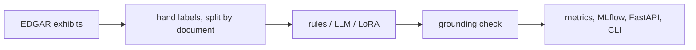

# filing-extractor

A personal project that pulls five loan terms (facility size, maturity, interest margin, lender, financial covenants) out of public SEC 8-K credit agreement text for ML and data teams, and marks a field `unresolved` when the text does not support it.

**Topics:** `information-extraction`, `lora`, `fine-tuning`, `sec-edgar`, `pydantic`, `mlflow`, `fastapi`, `nlp`


## Results

Command: `make eval`. 86 held-out test passages; 44% have no answer, so "unresolved" counts as correct in Exact match. Read Answer F1 too. Per-field detail and error analysis: [docs/RESULTS.md](docs/RESULTS.md).

<!-- results:start -->
| Extractor | Exact match | Answer F1 | Note |
|---|---|---|---|
| Rules (regex) | 0.947 | 0.713 | 86 passages, 27 documents, test split; 95% interval over documents 0.926 to 0.966 |
| Prompted LLM, structured output | pending | pending | pending, no `ANTHROPIC_API_KEY` was available; run `make eval` with a key |
| LoRA fine-tuned small model | pending | pending | pending, needs a GPU and has not been run yet |
<!-- results:end -->

## How it works



- `data/passages.jsonl`: 480 passages from 180 exhibits, labeled by hand; splits by document are 126, 27 and 27.
- Three extractors share one interface: regex rules, an LLM forced to call a tool shaped like the Pydantic model, and Qwen2.5 with PEFT.
- A grounding check turns any value not found verbatim in the passage into `unresolved`.
- Runs log to MLflow. `/extract` and the batch CLI pick the extractor with `FX_MODEL` or `--model`.
- The default is `rules`, the only one with measured numbers so far.

## Design choices

1. **Verbatim spans, not normalized values.** Labels are machine-checkable and a model cannot invent a value past the grounding check.
2. **`unresolved` is a value.** Blank equals blank inflated my first score (0.93 exact match on training data), so I added answer F1.
3. **Rules first.** They are the number any model has to beat.
4. **Split and bootstrap by document.** Amendments repeat paragraphs, so a passage split would leak.
5. **Second labeling pass for rare fields.** A random pass found 8 margin answers in about 490 passages; a targeted pass brought it to 30, still the thinnest field.

## Run it

Python 3.12 or 3.13. No API key, no GPU, no network needed.

```bash
python3 -m venv .venv && . .venv/bin/activate
make install
make demo        # stats, rules baseline on the test split, batch CLI, fake-LLM path, API call
```

More commands:

```bash
make eval        # val and test tables, error analysis, dataset stats (writes results/)
make serve       # API on http://localhost:8000, docs at /docs
curl -s localhost:8000/extract -H 'content-type: application/json' \
  -d '{"text": "...passage text...", "model": "rules"}'
filing-extract --model rules batch data/sample/demo_input.jsonl out.jsonl
```

- **Prompted LLM:** put `ANTHROPIC_API_KEY` in `.env` (see `.env.example`) and run `make eval`. Responses are cached in `results/llm_cache.jsonl`, so reruns cost nothing. Tests and the demo use a fake client with canned answers (`data/sample/`), which prove the plumbing and produce no metric.
- **LoRA smoke test on CPU:** `pip install -r requirements-train.txt && make smoke` (about 30 seconds of training after the 1 GB model download).
- **LoRA on a free GPU:** open `notebooks/train_lora_colab.ipynb` in Colab or Kaggle with a T4. It trains, scores the adapter next to the rules baseline and zips the results. Unzip them in this repo, run `python -m filing_extractor.readme_results`, and commit. The notebook has not been run on a GPU yet. Set `REPO` in the notebook to this repo's URL.
- **Refetch the data:** `scripts/find_exhibits.py` and `scripts/download_exhibits.py` read `SEC_USER_AGENT` (your name and email) from `.env` and stay under 7 requests a second. Passage picking and label merging are in `scripts/`; the labels themselves were written by hand.

## Tests

`make test` runs pytest on the committed data: metric arithmetic against hand-computed values, the grounding check, each regex, the LLM cache and fake client, the API and CLI, label integrity (every label is a verbatim span, no document crosses splits), and a check that the results table above equals what `results/metrics.json` produces. `make lint` runs ruff. CI runs both on Python 3.12 and 3.13.

## What I'd do next

- Label more passages, mainly margins and covenants, and have a second person label a sample to get an agreement score.
- Handle pricing grids as tables instead of flattened text.
- Run the GPU fine-tune on 0.5B and 1.5B, then compare with the LLM baseline on the same test passages.
- Add retrieval so a whole exhibit can be processed, not just a chosen passage.
- Calibrate: let the model say how sure it is, and route low-confidence fields to review.
