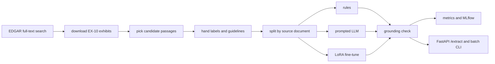

# filing-extractor

**Description:** Extracts loan terms from public SEC 8-K credit agreement exhibits into a typed schema, with rules, prompted-LLM and LoRA fine-tune baselines.
**Topics:** `information-extraction`, `lora`, `fine-tuning`, `sec-edgar`, `pydantic`, `mlflow`, `fastapi`, `nlp`

filing-extractor pulls five loan terms (facility size, maturity, interest margin, lender, financial covenants) out of credit agreement text in public SEC 8-K exhibits, for ML and data teams that need structured fields instead of PDFs. A field the text does not support is marked `unresolved` instead of guessed. It is a personal project on public data.


## Results

Test split: 86 labeled passages from 27 documents held out from training and from rule writing. Command: `make eval` (writes `results/`). Exact match counts "unresolved" on an unresolved field as correct, and 44% of passages have no answer, so read the answer-level columns too: Answer F1 looks only at predicted values, "EM, answerable only" only at passages that have an answer.

<!-- results:start -->
**Rules (regex)** (86 passages, 27 documents, test split)

| Field | Answerable | Exact match | Answer F1 | EM, answerable only | Unresolved rate | Answerable but unresolved | Answered but unanswerable |
|---|---|---|---|---|---|---|---|
| facility_size | 10 | 0.884 | 0.621 | 0.900 | 0.779 | 0.000 | 0.118 |
| maturity | 7 | 0.977 | 0.875 | 1.000 | 0.895 | 0.000 | 0.025 |
| interest_margin | 5 | 0.942 | 0.545 | 0.600 | 0.930 | 0.400 | 0.037 |
| lender | 12 | 0.977 | 0.870 | 0.833 | 0.872 | 0.083 | 0.000 |
| financial_covenants | 5 | 0.953 | 0.500 | 0.400 | 0.965 | 0.600 | 0.012 |
| **overall** | 39 | 0.947 | 0.713 | 0.795 | 0.888 | 0.154 | 0.038 |

Overall exact match 95% interval over documents: 0.926 to 0.966.

**Prompted LLM, structured output**: pending. No `ANTHROPIC_API_KEY` was available, so no numbers are reported. Run `make eval` with a key to fill this in.

**LoRA fine-tuned small model**: pending. Training needs a GPU and has not been run yet; the CPU smoke test only checks that the code runs. Numbers appear here after the GPU run.
<!-- results:end -->

- **Prompted LLM and LoRA rows are pending on purpose.** No Anthropic key was available here and there is no GPU on this machine. No number is shown until a run produces one.
- The CPU smoke test (`make smoke`, `results/smoke_train_summary.json`) trains 6 steps on 12 passages to check that the training and inference code runs. Its loss went from 0.793 to 0.033 in 28 seconds. That says nothing about quality.
- The test split has 5 to 12 answers per field. A difference of a few points between two models is inside the noise; the interval above resamples whole documents.
- Rules were written after reading the training and validation errors. I also labeled the test passages, so the rules row is mildly optimistic.

**Error analysis** (rules, validation and test, 48 wrong pairs out of 830; `results/error_analysis_rules.md` has every count and more examples):

1. Facility size, answered but unanswerable (18). The regex finds a dollar amount near the word "commitment" and takes it, but it is a sublimit, a participation threshold or a letter of credit commitment, not the facility (`fx0012`: "LC Commitment means ... $50,000,000").
2. Interest margin, answered but unanswerable (6). It reads a percentage from a Base Rate definition or a fee, such as "Term SOFR plus 1.00%" inside a definition (`fx0032`).
3. Maturity, answered but unanswerable (6). Any date after the word "Termination Date" is taken, even when it is the start of an interest payment schedule (`fx0057`, "commencing June 30, 2024").

Missed answers (11) sit mostly in interest margin and financial covenants, where the wording varies the most. Where the tuned model wins or loses, including long agreements against short loan papers (the table under each model in `results/results.md`), is pending the GPU run.

## How it works



- `data/passages.jsonl` holds 480 passages from 180 exhibits (public EDGAR text, source links in `data/sources.csv`), labeled by hand with the rules in `docs/LABELING_GUIDELINES.md`. Splits are by document: 126, 27 and 27 documents.
- Three extractors share one interface. Rules are regexes. The LLM baseline forces a tool call whose schema is the Pydantic model. The LoRA model is Qwen2.5 (0.5B by default, 1.5B in the notebook) fine-tuned with Transformers and PEFT to write the JSON answer.
- Every prediction goes through a grounding check: a value that is not found verbatim in the passage becomes `unresolved`.
- Evaluation runs and LoRA training runs log parameters and metrics to MLflow (SQLite file in `outputs/`; `mlflow ui --backend-store-uri sqlite:///outputs/mlflow.db`).
- `/extract` and the batch CLI pick the extractor with `FX_MODEL` or `--model`. The default is `rules`, the only model with measured numbers so far. After the GPU run, set `FX_MODEL=lora` if it wins.

## Design choices

1. **Verbatim spans, not normalized values.** I considered normalizing to numbers and ISO dates. I kept spans copied from the text, because a label can then be checked by machine (`tests/test_dataset.py` does it for all 480 passages) and a model cannot invent a value without the grounding check catching it.
2. **`unresolved` is a value, and the metrics treat it that way.** My first scoring script reported 0.93 overall exact match for the rules on training data. Most of that was blank-equals-blank. I added answer precision, recall and F1, the answerable-but-unresolved rate and the answered-but-unanswerable rate.
3. **Second labeling pass for rare fields.** The first random pass over the documents gave only 8 interest margin answers in about 490 passages, because pricing is mostly in grids. A second pass picked passages with rate and size wording, and 120 smaller loan papers were added to the pool. Margin ended with 30 answers, still the thinnest field.
4. **Split by document, interval by document.** Amendments of one agreement repeat the same paragraphs, so a passage split would leak. The bootstrap resamples documents for the same reason.
5. **Rules first, then models.** The rules baseline is the number any model has to beat. My first lender regex cut "Bank of America, N.A." to "America, N.A."; I caught it in the training errors and fixed it.

## Run it

Python 3.12 or 3.13. No API key, no GPU, no network needed.

```bash
python3 -m venv .venv && . .venv/bin/activate
make install
make demo        # stats, rules baseline on the test split, batch CLI, fake-LLM path, API call
```

More commands:

```bash
make eval        # val and test tables, error analysis, dataset stats (writes results/)
make serve       # API on http://localhost:8000, docs at /docs
curl -s localhost:8000/extract -H 'content-type: application/json' \
  -d '{"text": "...passage text...", "model": "rules"}'
filing-extract --model rules batch data/sample/demo_input.jsonl out.jsonl
```

- **Prompted LLM:** put `ANTHROPIC_API_KEY` in `.env` (see `.env.example`) and run `make eval`. Responses are cached in `results/llm_cache.jsonl`, so reruns cost nothing. Tests and the demo use a fake client with canned answers (`data/sample/`), which prove the plumbing and produce no metric.
- **LoRA smoke test on CPU:** `pip install -r requirements-train.txt && make smoke` (about 30 seconds of training after the 1 GB model download).
- **LoRA on a free GPU:** open `notebooks/train_lora_colab.ipynb` in Colab or Kaggle with a T4. It trains, scores the adapter next to the rules baseline and zips the results. Unzip them in this repo, run `python -m filing_extractor.readme_results`, and commit. The notebook has not been run on a GPU yet. The repo is private, so add a read-only GitHub token as a Colab or Kaggle secret named `GH_TOKEN` and edit the `REPO` line.
- **Refetch the data:** `scripts/find_exhibits.py` and `scripts/download_exhibits.py` read `SEC_USER_AGENT` (your name and email) from `.env` and stay under 7 requests a second. Passage picking and label merging are in `scripts/`; the labels themselves were written by hand.

## Tests

`make test` runs pytest on the committed data: metric arithmetic against hand-computed values, the grounding check, each regex, the LLM cache and fake client, the API and CLI, label integrity (every label is a verbatim span, no document crosses splits), and a check that the results table above equals what `results/metrics.json` produces. `make lint` runs ruff. CI runs both on Python 3.12 and 3.13.

## What I'd do next

- Label more passages, mainly margins and covenants, and have a second person label a sample to get an agreement score.
- Handle pricing grids as tables instead of flattened text.
- Run the GPU fine-tune on 0.5B and 1.5B, then compare with the LLM baseline on the same test passages.
- Add retrieval so a whole exhibit can be processed, not just a chosen passage.
- Calibrate: let the model say how sure it is, and route low-confidence fields to review.
